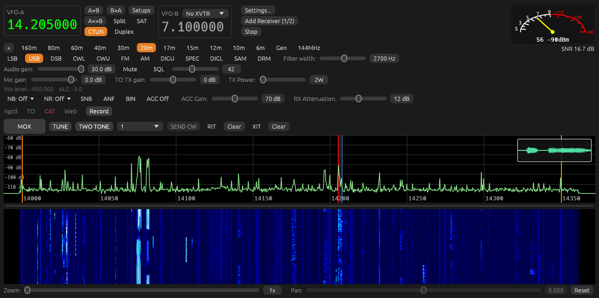
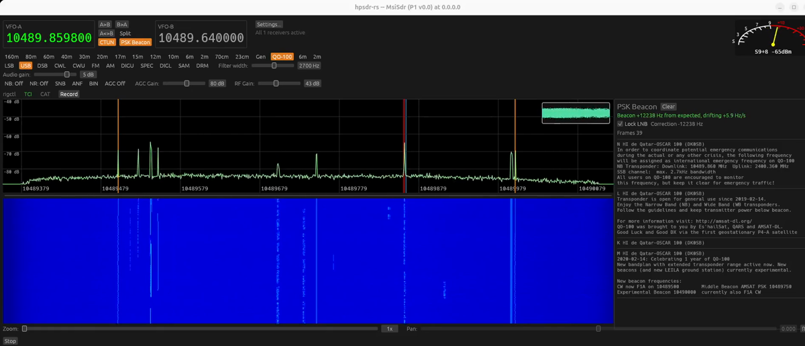

# hpsdr-rs


A Rust/egui desktop client for [openHPSDR](https://openhpsdr.org/) Protocol 1 and Protocol 2 radios (Metis/Ozy-style and Hermes/Orion-style boards), using [WDSP](https://github.com/NR0V/wdsp) for DSP.

**Website:** [g0orx.github.io/hpsdr-rs](https://g0orx.github.io/hpsdr-rs/) — a one-page summary of what hpsdr-rs supports, with download links.

> **Status: early / actively in development.** RX has seen the most real-world testing. TX works and has been used for real QSOs, but parts of the TX signal path are still noted in the source as unverified against the official protocol spec on untested hardware. **Always bench-test into a dummy load at reduced drive before transmitting into a real antenna**, especially after pulling a new build.



## Origins

This project started as an experiment: could Claude port the discovery code from rustyHPSDR -- originally written in GTK4 -- over to Rust's egui framework, which is more portable? That worked remarkably well. The plan at that point was to have Claude port the rest of rustyHPSDR to egui too, but that turned into a different question instead: having pointed Claude at the rustyHPSDR and piHPSDR source as reference, how much of a complete application could it actually develop from there? This project is the result so far. The only code I wrote by hand is the original discovery implementation that was ported to egui -- everything else came out of interacting with Claude and running real-hardware debugging sessions to chase down bugs.

-- John Melton, G0ORX/N6LYT

## Features

**Radios**
- openHPSDR Protocol 1 and Protocol 2 over Ethernet: Metis, Hermes, Angelia, Orion/Orion2 (the ANAN range) and Hermes Lite 2, found by broadcast discovery on every network interface or added by IP address
- The original Ozy/Mercury/Penny over USB (see [Ozy USB](#ozy-usb-legacy-hardware)), the ADALM-Pluto (RX and TX, see the [manual](docs/manual/24-pluto.md)), and receive-only [RX-888 Mk2](#rx-888-mk2-receive-only-direct-sampling-sdr), [RTL-SDR](#rtl-sdr-dongles-receive-only) and [MSI.SDR](#msisdr--msi2500-sticks-receive-only) dongles (several at once, each kept by USB port)
- Settings saved per radio (keyed by MAC address)

**Receive**
- Main receiver plus independent extra receiver windows, each with its own VFO, mode, filter and AF gain
- Spectrum/waterfall with Click-to-Tune (CTUN), adjustable dB range, palettes and automatic floor tracking
- SSB/CW/AM/FM/digital modes; filter, AF gain and mode remembered per mode and per band; band stack with 3 memories per band
- NB/NB2, NR/NR2/NNR, SNB, squelch; AGC Off/Long/Slow/Medium/Fast with adjustable gain
- Diversity reception, RX equalizer, built-in CW decoder, and Record to WAV

**Transmit**
- Mic audio through WDSP's TX chain with ALC, compressor, TX equalizer and power/SWR/ALC meters; TX also works with no local mic (CW, TCI audio, the radio's own mic)
- PureSignal (PA linearization) on both protocols, switchable live — see [PureSignal calibration](#puresignal-calibration) below
- Per-band 9-point PA calibration, Tune at a separate reduced power, two-tone test, TX spectrum
- Dual VFO with Split and Duplex, TX tail delay, FM repeater shift, CTCSS and selectable FM deviation
- CW: radio keyer settings with break-in, PC sidetone, five stored messages sent as CW, TX offset by the CW pitch

**Station integration**
- TCI (WebSocket, modelled on Thetis), rigctl (Hamlib) and Kenwood TS-2000 CAT servers for WSJT-X, N1MM+, Log4OM and similar; CAT also on up to 3 serial ports for amplifiers
- MIDI control surfaces with learn mode and Thetis Midi2Cat import
- Raspberry Pi front panels: piHPSDR's Controller 1, 2 V1, 2 V2 and G2 (GPIO and MCP23017 I2C)
- Open-collector outputs, filter boards (Alex, Apollo, Charly25, N2ADR), per-band RX/TX antennas, HL2 IO board and audio codec add-on
- Selectable RX output / TX input audio devices, for virtual audio cables

**VHF/UHF and satellite**
- Transverters up to 10 GHz (QO-100 via an LNB), QO-100 beacon monitor with LNB lock, and a [DVB-S2 DATV](#datv-dvb-s2-receive) receiver

**Also**
- hpsdr-remote: a thin client (native or in a browser) that operates hpsdr-rs remotely over TCI, including from a Raspberry Pi with a front-panel controller
- Compact layout for 7" displays (chosen automatically by screen size) and full screen
- FPGA firmware upload and static IP configuration — see [Firmware update](#firmware-update) below
- Installers for Windows (.msi), macOS (Apple Silicon) and Linux (AppImage, .deb, .rpm for x86_64 and ARM64); a [user manual](docs/manual/README.md), also as a PDF

## Supported hardware

Any board the standard openHPSDR discovery protocol reports as one of: Metis, Hermes, Hermes2, Angelia, Orion, Orion2, HermesLite, or HermesLite2 (this covers most Protocol 1/2 hardware, including the ANAN series). The discovery/board-type reply doesn't distinguish specific models or their actual max power (e.g. a 100W vs. 200W ANAN both report as Orion2) — set your radio's actual max TX power in Settings once connected.

Also, separately: the original Ozy/Mercury/Penny hardware (Protocol 1 over USB rather than Ethernet) — see [Ozy USB](#ozy-usb-legacy-hardware) below. **New, partially confirmed against real hardware.**

And separately again: the receive-only [RX-888 Mk2](#rx-888-mk2-receive-only-direct-sampling-sdr) direct-sampling SDR — see that section below. **Confirmed working against real hardware.**

And: receive-only [RTL-SDR dongles](#rtl-sdr-dongles-receive-only) (RTL2832U + R820T/R820T2/R828D tuner, e.g. the NooElec NESDR Smart) — see that section below. **Confirmed working on a real NESDR Smart v5.**

And: receive-only [MSI.SDR / MSi2500 sticks](#msisdr--msi2500-sticks-receive-only) (Mirics MSi2500 + MSi001, also the SDRplay RSP1) — see that section below. **Confirmed working on a real MSI.SDR stick.**

And: the [ADALM-Pluto](docs/manual/24-pluto.md) and its clones, reached over the network through the Pluto's own iiod server (no libiio needed). **Receive confirmed on real hardware (QO-100 and DATV); transmit checked by the chip's own loopback, not yet on air.**

## Building

Developed and tested primarily on Linux. A Windows build (via MSVC + vcpkg)
has also been confirmed to build and run successfully — see below. Two
Windows toolchains are supported. macOS builds successfully too, confirmed
via this repo's own CI (`.github/workflows/macos-build.yml`, real
`macos-latest` GitHub Actions hardware) — see its own section below.
Actually *running* it on macOS hasn't been confirmed against real radio
hardware yet, since CI has no radio to connect to.

**Linux:**
- A recent Rust toolchain (`rustup` recommended)
- FFTW3 development headers (`apt install libfftw3-dev` or your distro's equivalent)
- ALSA development headers for audio I/O (e.g. `apt install libasound2-dev`)

**macOS:**
- A recent Rust toolchain (`rustup` recommended)
- Xcode Command Line Tools, for a C compiler (`xcode-select --install`)
- [Homebrew](https://brew.sh/), then `brew install fftw pkg-config`
- No ALSA-equivalent package needed — `cpal` (audio I/O) talks to
  CoreAudio directly, built in to macOS
- Native (Apple Silicon or Intel) target, no cross-compilation flags
  needed — just `cargo build --release` like Linux
- The vendored WDSP C source (`build.rs`) branches on
  `#if defined(linux) || defined(__APPLE__)` internally via
  `vendor/wdsp/linux_port.c`/`.h`, ported by this project's own author
  from the upstream Windows-only source
- Confirmed building successfully via CI on real macOS hardware — not
  yet confirmed actually *running* against a real radio, so if
  something misbehaves at runtime on your Mac, please open an issue

**Windows via MSYS2/MinGW-w64:**
- [MSYS2](https://www.msys2.org/), then from an **MSYS2 MinGW64** shell: `pacman -S mingw-w64-x86_64-toolchain mingw-w64-x86_64-fftw mingw-w64-x86_64-pkg-config`
- Rust's `x86_64-pc-windows-gnu` target (`rustup target add x86_64-pc-windows-gnu`)
- Build with `gcc`/`pkg-config` reachable on `PATH` (either build from that same MSYS2 MinGW64 shell, or add `<msys2 install dir>\mingw64\bin` to your own shell's `PATH`) and `--target x86_64-pc-windows-gnu`

**Windows via MSVC:**
- Visual Studio Build Tools (C++ workload) — needed for any `x86_64-pc-windows-msvc`-target Rust build regardless of this project
- [vcpkg](https://vcpkg.io/), with `vcpkg install fftw3:x64-windows-static-md` (**not** `x64-windows-static` -- confirmed by reading the pinned `vcpkg` crate's own triplet-selection source: with neither `RUSTFLAGS=-Ctarget-feature=+crt-static` nor `VCPKGRS_DYNAMIC` set, which is the default/common case, it looks for the `-static-md` triplet specifically -- static `.lib`s built against the same dynamic CRT a normal Rust/MSVC build links against, not the fully-static `-static` triplet, which needs the static CRT to match; a real report installing the plain `-static` triplet hit exactly this mismatch as `LibNotFound("package fftw3 is not installed for vcpkg triplet x64-windows-static-md")`), and either `VCPKG_ROOT` set to your vcpkg checkout or `vcpkg integrate install` run once
- No `PATH`/pkg-config setup needed — `build.rs` talks to vcpkg and locates MSVC directly
- Confirmed building AND running successfully this way (2026-08-19)
- The [Firmware update](#firmware-update) feature additionally needs the [Npcap SDK](https://npcap.com/#download) at build time (its `Packet.lib`) — download and extract it, then set `NPCAP_SDK_DIR` to that folder; `build.rs` adds its `Lib/x64` to the linker's search path automatically (same idea as `VCPKG_ROOT` above, not a native cargo/MSVC mechanism). A real "`Packet.lib` not found" link error on a fresh Windows build confirmed this step is actually needed — if it still can't be found with `NPCAP_SDK_DIR` set, double check the SDK zip's actual internal folder layout against `<NPCAP_SDK_DIR>\Lib\x64\Packet.lib`
- **The Npcap *SDK* above (for building) is a separate download from the Npcap *application* (for running)** — a real report hit the built `.exe` refusing to even launch (`STATUS_DLL_NOT_FOUND` immediately on start, before reaching anything on screen) with only the SDK installed. `build.rs` now delay-loads `Packet.dll` (MSVC-only linker feature) so this should only actually matter if you use the Firmware Update feature itself, not just to run the app at all — but this isn't yet confirmed on a real Windows build, so until it is: install [Npcap itself](https://npcap.com/#download) too (not just the SDK), in "WinPcap API-compatible Mode", the same as [Firmware Update](#firmware-update)'s own runtime requirement below

WDSP is vendored as C source under `vendor/wdsp` and built automatically from source by `build.rs` (via the `cc` crate) — no separate build step, and no prebuilt platform-specific binaries to obtain or keep in sync.

```sh
cargo build --release
```

## Running

```sh
cargo run --release
```

The app opens a discovery window that listens for radios on the network; select one to connect. Settings (frequency, mode, filter width, TX power, calibration, etc.) are saved automatically per-radio under `~/.config/hpsdr-rs/` (Linux), `%APPDATA%\hpsdr-rs\` (Windows), or `~/Library/Application Support/hpsdr-rs/` (macOS).

On Windows, a release build no longer pops up a console window alongside the app (a plain `cargo build`/`cargo run` debug build still does, for normal development) — its debug output goes to `%APPDATA%\hpsdr-rs\hpsdr-rs.log` instead.

The main window's toolbar has a **Record** button that saves the RX audio you're currently hearing to a WAV file under a `recordings` folder alongside the settings above — useful for capturing a signal to play back later, or to demonstrate a feature (see the [Noise Reduction demo](#noise-reduction-demo) below for an example).

See the **[User Manual](docs/manual/README.md)** for a full walkthrough of the UI -- every settings tab, tuning gestures, extra receivers, and the PureSignal/Diversity/Equalizer features.

## Firmware update

Two independent, unrelated ways to update a radio's FPGA firmware (`.rbf` file) or change its static IP, matching how the openHPSDR reference tools (Apache Labs' `HPSDRBootloader`/`HPSDRProgrammer`) split this into two separate utilities:

- **Bootloader mode** (Discovery screen → **Firmware Update...**) — for Metis, Hermes, Hermes2, Angelia, Orion, and Orion2. The radio must already be physically switched into bootloader mode (a jumper or slide switch, board-dependent) and power-cycled — nothing over the network can do this for you. Uses raw Ethernet frames, **not** IP/UDP, so it only works over a direct cable or a plain unmanaged switch (not through a router, VPN, or most managed switches), and needs elevated privileges on every platform:
  - **Linux**: run as root, or grant the built binary the capability once: `sudo setcap cap_net_raw+ep target/release/hpsdr-rs`
  - **Windows**: install [Npcap](https://npcap.com/) (in "WinPcap API-compatible mode") and run hpsdr-rs as Administrator
  - **macOS**: run as root, or grant access to `/dev/bpf*`
  
  If an upload is interrupted (dropped packet, timeout, cancelled) the radio's bootloader firmware itself has no way to recover — **power-cycle the radio before trying again**. This can't brick the radio permanently: Erase/Program can only reach the separate "Application" flash region, never the bootloader/recovery image itself.

- **In-application update** (while connected → Settings → Network → **Firmware Update...**) — works against a normally-running, already-connected radio, no physical switch needed. Less thoroughly verified than bootloader mode — prefer bootloader mode when available. Automatically stops this radio's active session first (required for the radio to actually respond) and reconnects once the update completes.

See the manual's **[Firmware Update](docs/manual/13-firmware-update.md)** page for the full step-by-step procedure and warnings.

## Ozy USB (legacy hardware)

> **New, partially confirmed against real hardware.** USB discovery and
> the FX2 firmware load stage have both been confirmed working on a
> real Ozy. FPGA bitstream load, RX/TX streaming, and I2C telemetry
> (Penny power/Mercury overload) are still unconfirmed — this
> development environment has no complete Ozy/Mercury/Penny setup to
> test the rest against. If you try it, reports (good or bad) are very
> welcome.

The original HPSDR hardware — an "Ozy" board (Cypress FX2 USB
controller + FPGA) paired with separate Mercury (RX) and Penny (TX/audio
codec) boards on a backplane — predates every other board this project
talks to, which all use Ethernet/UDP. Ozy speaks the same Protocol 1
framing over raw USB bulk transfers instead, and needs a bit of one-time
setup normal boards don't:

1. **Firmware files** — the Cypress FX2 RAM firmware (`ozyfw-sdr1k.hex`)
   and the FPGA bitstream (`Ozy_Janus.rbf`) are **bundled with
   hpsdr-rs** (sourced from the author's own piHPSDR repo, under the
   GPL-2.0 license) — a `.deb` install or a `cargo run` from a source
   checkout both find them automatically, no setup needed. The
   Discover window's **Ozy USB setup** section shows which copy is in
   use and lets you override it with a different/custom build via
   **Choose...** if you ever need to.
2. **Linux only**: a udev rule for non-root USB access. Copy
   [`assets/90-ozy.rules`](assets/90-ozy.rules) to `/etc/udev/rules.d/`,
   then `sudo udevadm control --reload-rules && sudo udevadm trigger`
   (or just replug the device).
3. **Windows only**: Ozy's `fffe:0007` VID:PID needs a WinUSB driver
   bound to it via [Zadig](https://zadig.akeo.ie/) — Windows has no
   built-in generic driver for an unrecognized USB device.
4. **macOS**: no extra driver needed (nusb, the USB library this
   project uses, talks to IOKit directly) — untested either way.

Once set up, Ozy shows up in the normal Discover window like any other
radio (as "USB" instead of an IP address) — select it and click Start.
Connecting runs the full one-time bring-up (FX2 firmware load, a few
seconds for the device to re-enumerate, FPGA bitstream load) before
streaming begins, so the first connect takes noticeably longer than a
network radio.

Classic Ozy hardware is capped at 2 receivers (matching piHPSDR's own
documented limit — these boards are reported to hang with more), and
Diversity/PureSignal aren't available on it (no independent feedback
ADC in this hardware generation).

## RX-888 Mk2 (receive-only direct-sampling SDR)

> **Confirmed working** against a real RX-888 Mk2.

An RX-888 Mk2 is a receive-only SDR (Cypress FX3 + LTC2208-class ADC)
with two input paths: a direct-sampling HF path that streams its
*entire* captured bandwidth as raw ADC samples with no DDC of its own,
and a separate on-board VHF/UHF tuner path. hpsdr-rs only supports the
direct-sampling HF path so far — the on-board tuner isn't supported yet.
On the HF path, hpsdr-rs does the digital down-conversion (NCO mixer +
CIC decimator) itself in software, and supports up to **8 simultaneous,
independent receivers** (see [Extra
Receivers](docs/manual/03-extra-receivers.md), each on its own CPU core)
with **96/192/384kHz** selectable sample rates — see
[the full RX-888 Mk2 chapter](docs/manual/20-rx888-mk2.md) for details.

1. **Firmware file** — the Cypress FX3 RAM image (`SDDC_FX3.img`) is
   **bundled** with hpsdr-rs (MIT-licensed; see
   [`assets/rx888/PROVENANCE.md`](assets/rx888/PROVENANCE.md) for its
   real upstream), so no setup is needed here by default. Point the
   Discover window's **RX-888 USB setup** section at a different copy
   via **Choose...** only if you want to override it.
2. **Linux only**: a udev rule for non-root USB access. Copy
   [`assets/90-rx888.rules`](assets/90-rx888.rules) to
   `/etc/udev/rules.d/`, then
   `sudo udevadm control --reload-rules && sudo udevadm trigger` (or
   just replug the device).
3. **Windows only**: needs a WinUSB driver bound to both the unloaded
   (`04b4:00f3`) and loaded (`04b4:00f1`) PIDs via
   [Zadig](https://zadig.akeo.ie/), same reasoning as Ozy's `fffe:0007`.
4. **macOS**: no extra driver needed (nusb talks to IOKit directly) —
   untested either way.

Once set up, the RX-888 shows up in the normal Discover window like any
other radio (as "USB" instead of an IP address) — select it and click
Start. The receiver's step attenuator (0-31dB) reuses the existing
RX Attenuation control (main window, next to AGC Gain) rather than adding a new one.

## RTL-SDR dongles (receive-only)

> **Confirmed working** on a real NooElec NESDR Smart v5 (HF direct
> sampling, 2m and 70cm).

RTL2832U-based dongles with a Rafael Micro R820T, R820T2 or R828D tuner
— the NooElec NESDR Smart, RTL-SDR Blog V3/V4 and most generic DVB-T
sticks. (Older E4000/FC0012/FC0013/FC2580-tuner sticks aren't supported.)
The driver is a pure-Rust port of osmocom librtlsdr over nusb, so there's
no librtlsdr or libusb to install.

- Tunes **~24 MHz – 1.766 GHz** with the tuner; **2m, 70cm and 23cm**
  band buttons appear for it alongside 10m/6m.
- Below 24 MHz, **direct sampling** (Settings → RX, Q or I branch) is used
  automatically; an RTL-SDR Blog V4 uses its built-in HF upconverter instead.
- **RF Gain** (0–50 dB) is on the main window next to AGC Gain; **Tuner AGC** is in Settings → RX.
- Sample rates **48–1536 kHz**; one receiver.

Setup:

1. **Linux only**: copy [`assets/90-rtlsdr.rules`](assets/90-rtlsdr.rules)
   to `/etc/udev/rules.d/`, then
   `sudo udevadm control --reload-rules && sudo udevadm trigger` (or
   replug). The kernel's DVB-T driver doesn't need blacklisting —
   hpsdr-rs detaches it when it opens the dongle.
2. **Windows only**: bind WinUSB to the dongle (usually `0bda:2838`)
   with [Zadig](https://zadig.akeo.ie/), the same as for any other
   RTL-SDR software.
3. **macOS**: no extra driver needed — untested.

See [the full RTL-SDR chapter](docs/manual/21-rtl-sdr.md).

## MSI.SDR / MSi2500 sticks (receive-only)

> **Confirmed working** on a real MSI.SDR stick.

Mirics MSi2500 + MSi001 receivers (USB `1df7:2500`): the cheap
"MSI.SDR" sticks and the original SDRplay RSP1. The driver is a pure-Rust
port of libmirisdr-4 over nusb, so there's no libmirisdr, SDRplay API or
libusb to install.

- Tunes **HF to ~2 GHz** natively (no direct-sampling mod needed); every
  HF band plus **2m, 70cm and 23cm** band buttons.
- **RF Gain** (0–102 dB) is on the main window next to AGC Gain.
- Sample rates **48–1536 kHz**; one receiver.
- **Wide stream**: 4608 kHz with the 5 MHz IF filter, for
  [DATV](#datv-dvb-s2-receive) and other wide signals.

Setup:

1. **Linux only**: copy [`assets/90-mirisdr.rules`](assets/90-mirisdr.rules)
   to `/etc/udev/rules.d/`, then
   `sudo udevadm control --reload-rules && sudo udevadm trigger` (or
   replug). The kernel's `msi2500` driver doesn't need blacklisting:
   hpsdr-rs detaches it when it opens the stick.
2. **Windows only**: bind WinUSB to `1df7:2500` with
   [Zadig](https://zadig.akeo.ie/). Untested.
3. **macOS**: no extra driver needed. Untested.

See [the full MSI.SDR chapter](docs/manual/22-msi-sdr.md).

## DATV (DVB-S2 receive)

> **New, not yet confirmed off-air**: decodes video end to end from
> synthetic test signals, and finds the real QO-100 wideband beacon's
> frames.

With an RTL-SDR or MSI.SDR, the **DATV** window receives DVB-S2 digital
TV, such as QO-100's wideband transponder, and sends the MPEG transport
stream over UDP for VLC or ffplay to show. It handles QPSK and 8PSK,
every code rate, normal and short frames, with or without pilots. The
receiver is written from the DVB-S2 standard (ETSI EN 302 307-1) for this
project. Either dongle can also record its whole raw stream as SigMF.

See [the DATV chapter](docs/manual/23-datv.md).

## Packaging (Debian/Ubuntu)

A `.deb` can be built with [`cargo-deb`](https://crates.io/crates/cargo-deb):

```sh
cargo install cargo-deb   # one-time
cargo deb
```

This produces `target/debian/hpsdr-rs_<version>_amd64.deb`, installing the binary to `/usr/bin/hpsdr-rs`, a desktop menu entry and app icon, and the README/manual under `/usr/share/doc/hpsdr-rs/`. Runtime dependencies (FFTW3, ALSA, etc.) are detected automatically from the built binary. Install with:

```sh
sudo apt install ./target/debian/hpsdr-rs_<version>_amd64.deb
```

If the project directory is under your home directory (the normal case), `apt` will likely print `Notice: Download is performed unsandboxed as root as file '...' couldn't be accessed by user '_apt'.` — harmless: `_apt` (the low-privilege user apt sandboxes its acquire step with) can't traverse into a private home directory (`drwxr-x---` by default), so apt just does that one step unsandboxed as root instead and warns about it. The install still succeeds; confirm with `dpkg -l hpsdr-rs`. To avoid the warning entirely, either `sudo dpkg -i` the file directly instead of `apt install`, or copy it to a world-readable path first (e.g. `/tmp`) before running `apt install` on it.

Rebuilding and reinstalling repeatedly (e.g. while testing local changes) with the crate's own `version` unchanged produces the exact same package version every time — `dpkg`/`apt` treat that as nothing to do, requiring `sudo dpkg -r hpsdr-rs` before the new one will install. `./scripts/build-deb.sh` avoids this: it's a thin wrapper around `cargo deb --deb-revision <n>` that auto-increments a local counter (`.deb-revision`, gitignored) on every run, so each build gets a genuinely newer Debian revision and installs over the previous one cleanly. It also builds with `HPSDR_PORTABLE=1` (no `-march=native`), so the package runs on other machines' CPUs, not just the one it was built on; a bare `cargo deb` doesn't. Use it exactly like `cargo deb` — extra arguments are passed through, e.g. `./scripts/build-deb.sh --no-build`.

## Packaging (AppImage, any Linux distribution)

An AppImage is a single file that runs on most Linux distributions without installing anything:

```sh
chmod +x hpsdr-rs-<version>-x86_64.AppImage
./hpsdr-rs-<version>-x86_64.AppImage
```

x86_64 and aarch64 (e.g. Raspberry Pi 5) AppImages are attached to each GitHub release. To build one yourself, with the same prerequisites as a normal build plus `curl`:

```sh
./scripts/build-appimage.sh
```

This produces `hpsdr-rs-<version>-<arch>.AppImage` in the project root, including the Ozy and RX-888 firmware. It downloads the pinned `linuxdeploy` tools into `target/appimage-tools` on first use, and builds without `-march=native` so the result runs on other CPUs. An AppImage only runs on systems with a glibc at least as new as the one it was built on, so build on the oldest distribution you want to support (the release AppImages are built on Ubuntu 22.04). FFTW3 is bundled; ALSA and the graphics libraries come from the host system.

USB radios (Ozy, RX-888, RTL-SDR, MSI.SDR) still need their udev rules installed by hand, as described in each radio's section above. The rules files are inside the AppImage under `usr/share/doc/hpsdr-rs/`; `./hpsdr-rs-<version>-x86_64.AppImage --appimage-extract` unpacks them.

## Packaging (RPM: Fedora, RHEL, openSUSE)

x86_64 and aarch64 `.rpm` packages are attached to each GitHub release. Install with your distribution's package manager, which also pulls in FFTW3 and ALSA:

```sh
sudo dnf install ./hpsdr-rs-<version>-1.x86_64.rpm                          # Fedora, RHEL
sudo zypper install --allow-unsigned-rpm ./hpsdr-rs-<version>-1.x86_64.rpm  # openSUSE
```

The package installs the same files as the `.deb` (binary, desktop entry and icon, AppStream metadata, manual, Ozy and RX-888 firmware), and like the `.deb` it ships the udev rules for USB radios under `/usr/share/doc/hpsdr-rs/` for you to install by hand. The package isn't signed, which is why openSUSE needs `--allow-unsigned-rpm`.

To build one yourself, using [`cargo-generate-rpm`](https://crates.io/crates/cargo-generate-rpm) (no `rpmbuild` needed, so this works on any distribution):

```sh
cargo install cargo-generate-rpm   # one-time
./scripts/build-rpm.sh
```

This produces `target/generate-rpm/hpsdr-rs-<version>-1.<arch>.rpm`. Library dependencies are worked out from the built binary, so the one package suits every RPM distribution. It does need a glibc at least as new as the build machine's, so build on the oldest system you want to install on (the release RPMs are built on Ubuntu 22.04 and tested on Fedora and openSUSE Tumbleweed).

## Packaging (Windows)

An `.msi` installer can be built with [`cargo-wix`](https://crates.io/crates/cargo-wix), from a normal PowerShell prompt on a Windows machine already set up for the [MSVC build](#windows-via-msvc) above — this only packages an existing working build, it doesn't set one up:

```powershell
cargo install cargo-wix   # one-time
# Also one-time: install the WiX Toolset v3 (https://wixtoolset.org/)
# so candle.exe/light.exe are reachable (its installer normally adds
# the WIX env var pointing at them automatically)
.\scripts\build-windows-release.ps1
```

If PowerShell says running scripts is disabled, run it once with
`powershell -ExecutionPolicy Bypass -File scripts\build-windows-release.ps1`,
or allow your own scripts for good with
`Set-ExecutionPolicy -Scope CurrentUser RemoteSigned` (no administrator
rights needed). The script builds the web client first (so the installed
hpsdr-rs has it built in), then the installer with `cargo wix -p hpsdr-rs` --
the `-p` is needed because the repository is a Cargo workspace.

This produces `target\wix\hpsdr-rs-<version>-x86_64.msi`, which installs `hpsdr-rs.exe` (icon embedded, via `winresource` in `build.rs`) under `Program Files\hpsdr-rs\bin`, adds that folder to `PATH`, and bundles the `LICENSE` file. The installer/uninstaller icon and WiX packaging config live in `wix/main.wxs` (generated once via `cargo wix init`, then hand-edited — see its own comments for how to further customize the install UI). Unlike the `.deb` case above, there's no local revision counter needed: WiX's `<MajorUpgrade>` element already reinstalls cleanly over an older version, so between releases just bump Cargo.toml's `version` like any other platform. **Not yet confirmed on real Windows hardware** — the MSI itself was authored and generated from Linux (WiX's `candle.exe`/`light.exe` are Windows-only, so the actual `.msi` build has to happen on a real Windows box); report back if `cargo wix` or the resulting installer misbehaves.

## PureSignal calibration

PureSignal is enabled in Settings (takes effect on the next connect), then configured live in Settings → PureSignal while transmitting. The one setting that actually matters — and the thing to change first if calibration won't complete or `Correcting` never turns on — is **HW Peak**, which has to track the *real* envelope peak your radio produces at whatever drive level you're actually calibrating at. It is not a fixed per-board constant to leave alone, and the **Feedback Level** meter's "ideal" 90-256 range is only a rough guide, not a hard requirement — calibration has been confirmed working on real hardware at feedback levels both far below (single digits) and far above (thousands) that range, as long as HW Peak itself is right.

Procedure, on any radio:
1. Set **Tune Power %** low (start around 10-15%) — PureSignal calibration works best at a low real TX drive level, not a normal operating power.
2. Press **Two Tone** (not Tune — a steady tone's constant envelope can never fill PureSignal's calibration buckets) and watch **Measured Peak TX** in the PureSignal panel for a few seconds.
3. Set **HW Peak** to just above whatever Measured Peak TX settled at.
4. Re-engage Two Tone. `Correcting` should turn on within a few seconds. If it doesn't:
   - Stuck with Feedback Level at 0 and no progress: HW Peak is likely still too far from the true peak — recheck Measured Peak TX and adjust again.
   - `Correcting` flickers on/off or never turns on despite Feedback Level being nonzero: try nudging Tune Power % up or down a little and repeat from step 2 — the exact drive level a clean calibration converges at is somewhat radio-dependent.

## Noise Reduction demo

A real recording of 40m background noise, captured with the main window's own Record button (see [Running](#running) above), showing each of the Settings → RX → Noise Reduction options back to back on the same noisy signal. **[Listen to it here](https://g0orx.github.io/hpsdr-rs/audio-demo.html)** (GitHub Pages — GitHub itself doesn't support playing audio directly from a README or a repository file page), or [download the raw file](docs/audio/noise-reduction-demo.wav).

| Time | NR setting |
| --- | --- |
| 0-4s | `NR: Off` |
| 4-9s | `NR: NR` |
| 9-13s | `NR: NR2` |
| 13s-end | `NR: NNR` |

## QO-100 demo

[](https://g0orx.github.io/hpsdr-rs/qo100-demo.html)

A screen recording of the QO-100 narrowband transponder received with an MSI.SDR stick and a 10 GHz LNB, set up as a [transverter](docs/manual/18-xvtr.md). The PSK Beacon panel is decoding the middle beacon, and Lock LNB is correcting the LNB's drift. **[Watch it here](https://g0orx.github.io/hpsdr-rs/qo100-demo.html)** (GitHub Pages — GitHub doesn't play video from a README), or [download the MP4](docs/video/qo100.mp4).

## Roadmap

Current focus is on stabilizing and testing Protocol 1 and Protocol 2 operation, including PureSignal, across more radios.

## Contributing

Issues and pull requests are welcome. A few things that'll help:

- **For anything touching the TX path**: bench-test into a dummy load at reduced drive before a real antenna, and say in the PR description what you actually tested it against (mode, protocol, hardware). Several TX bugs in this project's history turned out to be protocol- or radio-specific, so mentioning which you used helps a lot.
- **Reference-driven DSP/protocol changes**: where this project's behavior is meant to match a known-working implementation (piHPSDR, rustyHPSDR, Thetis, or the official openHPSDR protocol docs/WDSP source), please check against the actual reference rather than a plausible-sounding guess, and say which reference and where in the PR/commit message. A few real bugs here came from parameter changes that sounded reasonable but turned out not to match how any working reference actually behaves.
- **Comments**: explain *why*, not *what* -- code should already say what it does. A comment earns its place by capturing a non-obvious constraint, a reference confirmation, or the reasoning behind a fix, not by restating the line below it.
- For larger changes, opening an issue first to discuss the approach is appreciated before investing in a big PR.

## License

GNU General Public License, version 3 or (at your option) any later version -- see [LICENSE](LICENSE). It was version 2 or later until the ANAN G2 (Saturn) XDMA support, which is ported from piHPSDR's GPL-3.0-or-later Saturn code. WDSP, which hpsdr-rs statically links against, is GPL version 2 or later, so it can be used under version 3.
