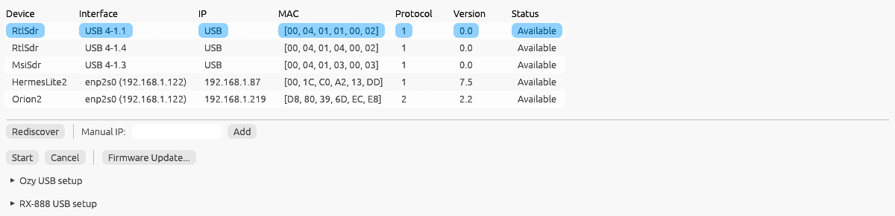

[Index](README.md) | [Main Window →](02-main-window.md)

# Getting Started

## Installing and running

See the [top-level README](../../README.md#building) for build requirements
and instructions. Once built:

```sh
cargo run --release
```

### On Windows

Install the `.msi`; hpsdr-rs is then in the Start Menu. It has no console
window, so everything it would print -- status lines, warnings, and the
reason if it stops -- goes to a log file instead:
`%APPDATA%\hpsdr-rs\hpsdr-rs.log` (type that into the Win+R box to open
the folder). The previous run's log is kept as `hpsdr-rs.prev.log`. The
log only gets its first lines once you connect to a radio, so an empty
one means hpsdr-rs stopped before then.

hpsdr-rs draws with DirectX 12, falling back to OpenGL. If it won't start
at all, look in Event Viewer (Windows Logs, then Application) for an
**Application Error** from `hpsdr-rs.exe`: a faulting module that's a
graphics driver points at that driver. One older Intel driver crashed
just by Vulkan being started (it no longer is), and updating the graphics
driver is the general cure. To choose the graphics API yourself, set
`WGPU_BACKEND` to `dx12`, `vulkan` or `gl` -- e.g. `setx WGPU_BACKEND gl`
in a Command Prompt, which takes effect for programs started afterwards.

## Discovering your radio

On launch, the **Discover HPSDR Radios** list opens automatically and
immediately starts discovering radios on all the network interfaces (standard
openHPSDR UDP discovery broadcast, port 1024). On Linux under Wayland (the
usual desktop today) it's shown inside the main window; elsewhere it's a
separate window.



The window lists every radio that responded, one row per device, with
columns:

| Column | Meaning |
|---|---|
| Device | Board type (e.g. `Orion2`, `Hermes`, `HermesLite2`) |
| Interface | The local network interface the reply was heard on -- name and IP address (e.g. `eth0 (192.168.1.50)`), or just the IP if the interface's name isn't known (a manually-entered IP, see below) |
| IP | The radio's own IP address |
| MAC | The radio's MAC address (also used as the key for its saved settings) |
| Protocol | 1 (Metis/Ozy-style) or 2 (Hermes/Orion-style) |
| Version | Firmware version |
| Status | **Available** or **In Use** |

Click anywhere on a row to select it -- the whole row highlights. Only
**Available** radios can be selected and started; a radio already **In Use**
(by another client, or another instance of this app) is shown but disabled.
Double-clicking an **Available** row starts it immediately, same as
selecting it and pressing **Start**.

The first **Available** radio in the list is selected automatically as
soon as results land (skipping over any radio already **In Use**), so you
can usually just click **Start** -- or double-click that row.

**Rediscover** clears the current list and scans again -- useful if your
radio was slow to respond or you just powered it on.

**Manual IP** lets you connect directly to a known IP address instead of
waiting for a broadcast reply to arrive, which is useful if your radio is on
a different subnet than broadcast discovery can reach (e.g. across a router
that doesn't forward broadcasts). Type the address into the field and click
**Add**; if a radio responds there, it's added to the list the same as a
broadcast-discovered one.

A successfully-reached address is remembered under **Saved manual
addresses**, so you don't have to retype it next time -- every saved address
is automatically retried in the background each time this window opens, and
shows up in the list on its own if the radio responds. Each saved entry also
has its own **Retry** (re-check it right now) and **Forget** (remove it)
buttons.

**Firmware Update...** opens a separate window for updating a radio's FPGA
firmware or changing its IP address while it's in bootloader mode -- see
[Firmware Update](09-firmware-update.md).

**Ozy USB setup** is for the original HPSDR hardware (an Ozy board with
separate Mercury/Penny boards), which connects over USB instead of the
network and needs a one-time driver/firmware setup before it shows up in
this list -- see [Ozy USB](19-ozy-usb.md) for the full walkthrough.

## Connecting

With a radio selected, click **Start**. The app connects, opens the main
window, and restores that radio's last-used settings (frequency, mode,
filter width, calibration, etc.) automatically -- each physical radio (by
MAC address) keeps its own independent saved configuration, so switching
between radios doesn't mix up their settings.

To disconnect, use the **Stop** button under **Settings...** at the top of
the main window.
This returns you to the discovery window.

If the spectrum stays blank with **Waiting for samples from the
radio...**, hpsdr-rs is connected but no receive data is arriving. The
usual cause is the network: check the cable and its connectors (a
reseated plug has fixed this), and that nothing between the PC and the
radio is dropping traffic. For a Protocol 2 radio, starting hpsdr-rs with
`HPSDR_P2_DEBUG=1` set prints the first packet from each of the radio's
ports: status (1025) and microphone (1026) packets arriving with no IQ
(1035 and up) means the radio hears hpsdr-rs but its receive data isn't
getting back.

---

[Index](README.md) | [Main Window →](02-main-window.md)
