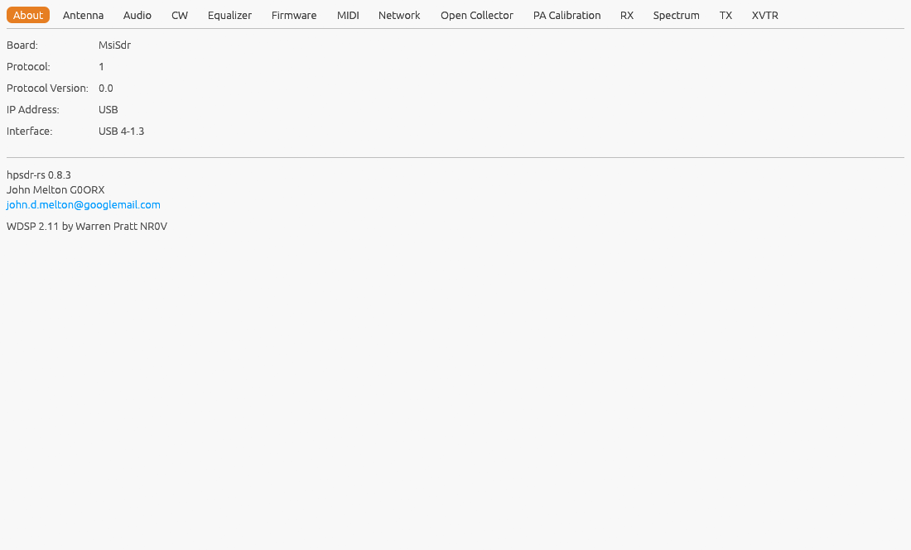

[← Extra Receivers](03-extra-receivers.md) | [Index](README.md) | [Audio →](05-settings-audio.md)

# Settings: About

Open **Settings...** from the main window, then the **About** tab.

Shows details of the radio currently connected to:

- **Board** -- the detected board type (e.g. Orion2, HermesLite2).
- **Protocol** -- 1 or 2 (openHPSDR Protocol 1/USB-style, or Protocol 2/
  Ethernet).
- **Protocol Version** -- the firmware's reported protocol version.
- **IP Address** -- the radio's own address on the network. Shows "USB"
  instead for the USB-connected boards, which have no network address:
  [Ozy](19-ozy-usb.md), [RX-888 Mk2](20-rx888-mk2.md), RTL-SDR and
  MSI.SDR.
- **MAC Address** -- the radio's hardware Ethernet address. Not shown
  for the USB-connected boards (no real MAC), or for a
  [Pluto](24-pluto.md), which is told apart by its serial number.
- **Interface** -- which of this computer's own network interfaces (e.g.
  `eth0`) the connection is using. For an RTL-SDR or MSI.SDR, the USB
  port it's plugged into (e.g. `USB 4-1.3` above), which tells two
  dongles apart; "USB" for Ozy and the RX-888.

Connected to Ozy USB specifically, three extra rows also appear: **Ozy
FX2 Version**, **Mercury FW** (one or two version numbers, separated by
`/` for a two-Mercury setup), and **Penny FW** -- all read once over I2C
at connect time.

Also shows the hpsdr-rs version, the author's name and contact email, and
the version of the WDSP DSP library (by Warren Pratt NR0V) built in.

---

[← Extra Receivers](03-extra-receivers.md) | [Index](README.md) | [Audio →](05-settings-audio.md)
