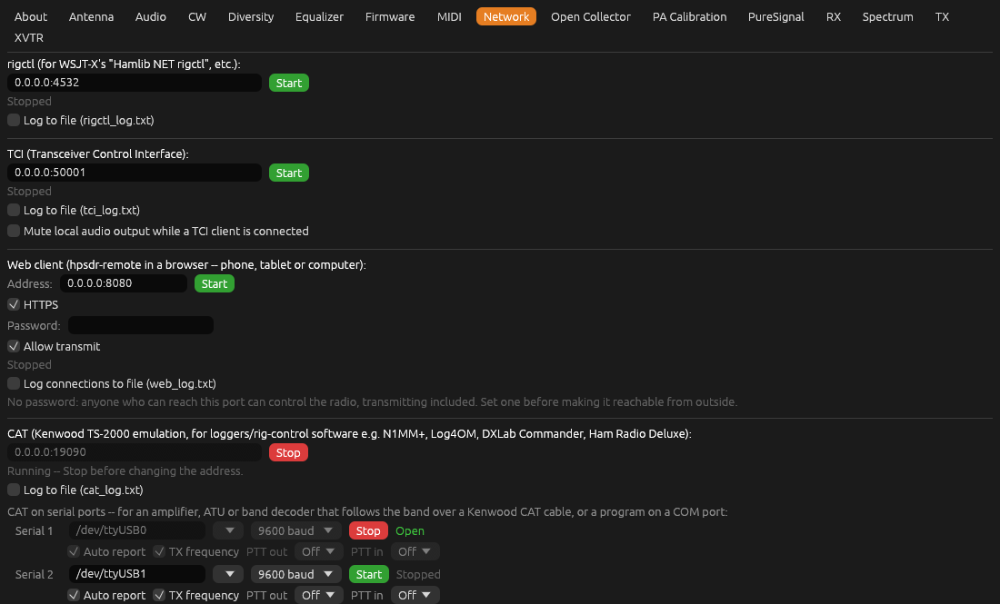
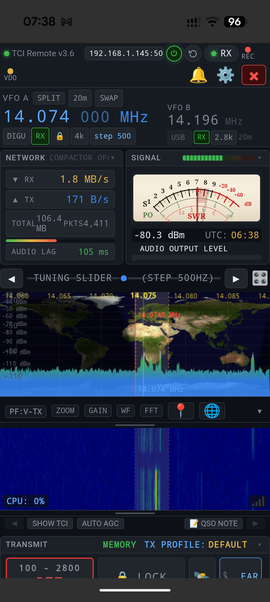
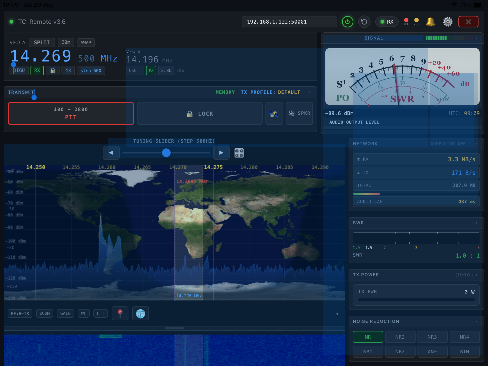

[← MIDI](10-settings-midi.md) | [Index](README.md) | [Open Collector →](12-open-collector.md)

# Settings: Network

Open **Settings...** from the main window, then the **Network** tab.

This tab starts and stops three optional control servers that let other
software (loggers, digital-mode programs, remote-control apps) drive
hpsdr-rs. Each server's **Start**/**Stop** button is colored green when it
would start the server, red when it would stop it. None of the three
require authentication, so only bind `0.0.0.0` (all interfaces) if you
trust your local network.

PTT sent through any of these three (rigctl's `set_ptt`, TCI's `trx`,
CAT's `TX;`/`RX;`) does drive the radio's real transmit (the same `mox`
flag as the on-screen **MOX** button and Spacebar hold-to-talk), but only
while Settings → TX → **Enable Transmit** is on -- with transmit not armed,
a PTT request is accepted (so the client's own handshake doesn't fail) but
has no receiver on the other end. The same transmit-frequency check as the
on-screen button applies too: inside the ham bands, or inside the active
transverter's RF range, unless Settings → TX → **Allow TX outside ham
bands** is on.

Frequencies are always exchanged in the frequency shown on screen: with a
[transverter](18-xvtr.md) active, clients see and set its RF frequency
(e.g. 10489.540 MHz on QO-100), never the radio's IF.

[RIT and XIT](02-main-window.md#transmit-controls) are readable and
settable through all three servers too, and stay in sync with the
on-screen **RIT**/**XIT** buttons in both directions -- a change made in
hpsdr-rs's own UI is visible to a connected client, and a change made by a
client shows up on screen, the same as any other setting.

## rigctl

Hamlib-compatible TCP control, for software that supports "Hamlib NET
rigctl" (e.g. WSJT-X, N1MM, and most logging/digital-mode programs).

- Address field (`host:port`) -- default `0.0.0.0:4532`.
- **Start** / **Stop** button. The address field is disabled while running
  -- stop the server before changing it.
- Status line shows **Running** (with a reminder to stop before changing
  the address) or **Stopped**. A red error line appears if the server
  fails to bind (e.g. the port is already in use).
- **Log to file (rigctl_log.txt)** -- optional debug logging of every
  command received and reply sent, saved in the same
  [settings folder](README.md#conventions-used-in-this-manual) as this
  radio's config.

`0.0.0.0` accepts connections from any machine on your network;
`127.0.0.1` restricts it to this machine only.

## TCI (Transceiver Control Interface)

A WebSocket-based control protocol, used by some digital-mode software
(e.g. as an alternative to rigctl for WSJT-X, or TCI Remote-style clients)
for both control and audio streaming. Confirmed working end-to-end on real
hardware: WSJT-X (control, RX audio, and TX audio via TCI, including a
successful on-air contact) and TCI Remote (control plus RX audio/IQ
streaming), both directly and through TCI Remote Compactor.

- Address field -- default `0.0.0.0:50001` (Thetis's own default TCI
  port, and what real-world TCI Remote/TCI Remote Compactor setups
  actually use).
- Same **Start**/**Stop**/status/logging behavior as rigctl above (logs to
  `tci_log.txt`).
- **VFO A and VFO B** are both reported to clients (`vfo:0,0` and
  `vfo:0,1`) and both can be set from them -- VFO B through its own
  transverter, the same as typing a frequency into it. The spectrum centre
  (`dds`) and the offset of the listening frequency from it (`if`) are
  reported in the same RF terms, so a client's own spectrum display lines
  up with a transverter band too.
- **A second receiver**, as Thetis's RX2: TCI receiver 1 is your first
  extra receiver (the **RX 2** window, or the lowest-numbered one open).
  Clients see two receivers, and `rx_enable:1` says whether there's one
  open now. A client can open one with `rx_enable:1,true` -- as **Add
  Receiver** does, if a receiver is free -- and close it with
  `rx_enable:1,false`, as closing its window does. Receiver 1 has its own frequency (VFO A and B), mode,
  filter, RIT, CTUN, AGC, volume, noise and squelch settings, audio
  (`audio_start:1`) and S-meter (`rx_sensors:1`), all reported as they
  change, and IQ (`iq_start:1`), each message giving receiver 1's own
  sample rate, which on Protocol 2 can differ from receiver 0's;
  transmitting stays with receiver 0.
- **CW is CWL or CWU**, as Thetis reports it, not plain CW. A client
  that sends plain `cw` gets the usual sideband for the frequency (CWL
  below 10 MHz, CWU above), and `cwr` the other one.
- **Changes reach clients at once:** keying MOX, Tune, tuning, changing
  mode, filter, RIT/XIT, split, AGC, volume, squelch, the noise controls,
  TX power or Tune power -- from hpsdr-rs's
  own window, MIDI, CAT or another client -- is sent to every TCI client
  as it happens, within a few milliseconds. A value a client has just
  set itself isn't echoed back to it for half a second, so a client
  that's still tuning doesn't jump back. TX power goes as TCI's `drive`,
  a percentage of the radio's maximum; squelch as `sql_level`, its 0-100
  setting scaled to TCI's -140 to 0 dB.
- **Split:** the transmit frequency is reported as Thetis does, at
  connect and whenever it changes -- `tx_frequency` and
  `tx_frequency_ex` (frequency, band such as `b40m`, whether receiver 1
  is open, whether TX is on VFO B). It's VFO A, or VFO B with Split or
  Duplex, as shown on screen (through its transverter), plus XIT. A
  client can turn Split on and off with `split_enable`, as the Split
  button does.
- **Clients can set** Tune (`tune`, with the same checks as the TUNE
  button), TX power (`drive`, a percentage of the radio's maximum), Tune
  Power (`tune_drive`), the filter (`rx_filter_band`), volume (`volume`
  or `rx_volume`, dB from -60 to 0), AGC (`agc_mode`, `agc_gain`) and
  squelch (`sql_enable`, `sql_level`), as in Thetis; sending one with
  only the receiver asks for its current value. hpsdr-rs's filters are a
  width placed by the mode, so `rx_filter_band` sets the width nearest
  the passband asked for (e.g. `-2400,-150` in LSB is 2.4 kHz). As with
  the filter control here, the TX filter follows, and the width is
  remembered for the mode.
- **Sensors** (`rx_sensors_enable` / `tx_sensors_enable`, as Thetis):
  while receiving, the S-meter level, its running average and the
  strongest spectrum bin (`rx_sensors`, `rx_channel_sensors`,
  `rx_channel_sensors_ex`); while transmitting, the mic level, power and
  SWR (`tx_sensors`) -- every 200 ms, or the interval the client asks
  for (30 to 1000 ms). The receive readings are only as fresh as the
  spectrum, about 10 a second.
- **Audio block size** follows the client, as in Thetis: 2048 samples
  (about 43 ms at 48 kHz) unless the client asks for a smaller size
  with `audio_stream_samples` (100 to 2048, e.g. 960 for 20 ms), used
  for both the receive audio it gets and the transmit audio asked of it.
- **Mute local audio output while a TCI client is connected** -- hpsdr-rs normally
  streams RX audio to both its own local audio device and TCI at the same
  time. If that local device is *also* independently picked up by your TCI
  client (e.g. a virtual audio cable left over from before TCI was set
  up), the client receives the same audio twice -- once via TCI, once via
  the device -- which shows up as a doubled/offset waterfall segment and
  fuzzy-sounding decodes. Enable this to mute only the local device output
  while at least one TCI client is connected; with the server running but
  no client connected, local audio plays as normal. TCI clients keep
  receiving audio normally either way.

### TCI Remote

TCI Remote is a mobile TCI client, available for both Android and iOS/
iPadOS, that connects to hpsdr-rs's TCI server over the network -- giving
you a remote VFO/mode/RIT-XIT/PTT control surface on a phone or tablet
without needing a full remote-desktop session. Point it at this machine's
IP address and the TCI port above (`50001` by default).

*Example of TCI Remote running on an Android Phone*

*Example of TCI Remote running on an Apple iPad*

On a microwave band such as QO-100, TCI Remote may show **OUT OF BAND**
over its waterfall. That comes from TCI Remote's own band plan, not from
hpsdr-rs -- the frequency, spectrum and tuning are all still correct.

## Web client

hpsdr-remote, hpsdr-rs's own remote client, in a web browser -- on a phone,
a tablet (iPhone and iPad included) or another computer, with nothing to
install. Enter the address to listen on (default `0.0.0.0:8080`), choose
**HTTPS** and a **Password**, and click **Start**; the line below then
gives the address to open, e.g. `https://192.168.1.122:8080`. The client
connects back through this same port to the **TCI** server, which must be
running too. Like the other servers here it starts again automatically
next time if it was running. To run two copies of hpsdr-rs on one
computer, give each its own port here (e.g. `0.0.0.0:8081` for the
second), and its own TCI port; if the port is already taken, the error
below the button says so and suggests the next one.

**HTTPS** (on by default) is needed to transmit: browsers only let a page
use the microphone over HTTPS. hpsdr-rs makes its own certificate the first
time (`web-cert.pem` and `web-key.pem`, kept with its settings), so the
first visit from each browser shows a warning that the connection isn't
private -- choose to continue (on Chrome: **Advanced**, then **Proceed**;
on Safari: **Show Details**, then **visit this website**). If you have a
certificate of your own for this computer's name, put it in those two
files instead.

The client shows the radio's spectrum and waterfall, its band buttons, the
VFO, mode, filter, AGC and noise controls, the S-meter, and the receive
audio (which starts when you press **Connect** -- browsers only start audio
after a tap). Tune by tapping or sliding on the spectrum or waterfall, by
sliding on the frequency, or with **-** and **+** and a chosen step. It
uses about 150 kbit/s, compressed, rather than the several Mbit/s of
standard TCI audio and IQ, plus about 70 kbit/s more while transmitting.
It's dark or light as the phone, tablet or browser is set, and changes when
that does; the spectrum and waterfall stay dark in both.

On a small screen -- a phone either way up -- it uses a compact layout,
like hpsdr-rs's own: just the frequency and S-meter above the spectrum,
and a toolbar of large buttons below it (Band, Mode, Step, Filter, Noise,
Audio, Key, TX, and MOX at the right). Each button opens its controls over
the spectrum; tap it again, or the close button, to close them.
**Layout**, beside the connection status, can choose **Standard** (every
control above the spectrum) or **Compact** instead of **Auto**.

To transmit, press **MOX**: the first time, the browser asks to use the
microphone. Press **MOX** again to stop. **Mic** sets its level (keep the
meter beside it out of the red), **Power** is the radio's TX power
setting, and the power and SWR show while transmitting. The radio
transmits only where it would from its own MOX button (in band, unless
out-of-band TX is allowed in Settings -> TX), and with **TX Audio Source**
left at **Auto**. If the connection drops, or the
client stops sending audio for a second -- a phone locked, a browser tab
put in the background -- the radio unkeys by itself.

In CW, **MOX** gives way to sending text: type it and press **Send** (or
Enter), or press one of your saved messages from Settings -> CW, shown
as buttons; **Stop** (red while sending) stops at once, and **Speed** is
the radio's own CW speed. The radio sends it exactly as its own **Send**
CW button does -- keying itself, and unkeying when the text is done -- so
network delays don't affect the timing. The same TCI commands work from
other TCI programs too (`cw_macros`, `cw_macros_stop`, `cw_macros_speed`).

You can also key live, with an on-screen key or paddles (**Key**, on a
phone a section of its own): **Straight** gives one big pad, down while
you hold it; **Iambic A** and **Iambic B** give **dit** and **dah** pads
side by side -- squeeze both with two fingers -- keyed at the CW speed, as
piHPSDR's keyer is (B adds one element when a squeeze is released during a
dah). You hear your own keying straight away, as a sidetone made in the
client (**Sidetone** sets its level). The radio sends it **Delay** later
(150 ms to start with), keeping your timing exactly however unevenly the
network delivers it -- raise it if the keying sounds broken up over a slow
or busy connection. The radio keys itself on your first element and
unkeys after the CW tab's **Break-in delay**; if the connection drops, or
the client goes quiet with the key down, the key is let go and the radio
unkeyed within a second and a half.

A real key or paddle can be plugged in too, through anything that looks
like a USB keyboard -- e.g. a small microcontroller, plugged into a phone
with an OTG cable -- that holds a key down while the dit paddle is closed
and another while the dah paddle is (a straight key: either): **[** and
**]** unless you choose others in Settings -> CW,
[Remote Paddle Keys](06-settings-cw.md#remote-paddle-keys). It's sent
through the same keyer, with the mode, speed and sidetone set here, and
lights the on-screen pads; it works whenever the client can key, with
**Key** open or not. While it can key, those two keys key rather than
type. Tap the client once first so the page has the keyboard.

Untick **Allow transmit** to let remote clients listen and tune but not
transmit: their **MOX** button disappears, and one already transmitting is
unkeyed at once. It takes effect straight away, without stopping the
server.

Set a **password** before making this port reachable from outside your own
network: without one, anyone who can reach it can control the radio,
transmitting included. TCI itself has no password, so for use over the
internet forward only this port; TCI's address can then be
`127.0.0.1:50001`, which the web client still reaches through here. A VPN
(WireGuard, Tailscale) or an SSH tunnel is safer still.

**Log connections to file** writes `web_log.txt`, kept with the settings,
one line per event with the connecting address: whether the HTTPS
handshake worked (a browser that hasn't yet accepted the certificate shows
up as a failed handshake), each page it fetched, and for the client's radio
connection whether it was refused -- wrong or missing password, TCI server
not running -- or how long it stayed open. The password itself is never
written. Like the other logs, it starts a fresh file each time it's
ticked, and it can be ticked while the server is running.

The web client is built into hpsdr-rs when it's built from source with the
web client built first (`crates/hpsdr-remote/build-web.sh`); without it,
the page says so.

## CAT (Kenwood TS-2000 emulation)

A plain-ASCII, semicolon-terminated command set for logging/rig-control
software that talks directly to a "Kenwood TS-2000" over a network socket
(e.g. N1MM+, Log4OM, DXLab Commander, Ham Radio Deluxe) rather than through
Hamlib's rigctld protocol. This is a different, separate protocol from
rigctl above, even though piHPSDR's own equivalent feature happens to be
named "rigctl" too.

- Address field -- default `0.0.0.0:19090` (matches piHPSDR's own default
  port, so a logger already configured against a piHPSDR station needs no
  changes to point at hpsdr-rs instead).
- Same **Start**/**Stop**/status/logging behavior as rigctl above (logs to
  `cat_log.txt`).
- Implements a practical subset of the TS-2000 command set: frequency,
  mode, PTT, S-meter, RIT/XIT, and a few identification/status commands.
  Commands with no clean equivalent in this app yet (drive/power level,
  mic gain, CW keyer speed, memory channels) respond `?;` or are accepted with
  no effect, rather than reporting a made-up value. XIT can only be
  toggled on/off (`XT`), not set to a specific value -- matches real
  Kenwood TS-2000 behavior, which has no such command either.
- **Auto reporting**: a client that sends `AI1;` is then sent `FA...;`
  whenever the frequency changes, and with `AI2;` also `MD...;` whenever
  the mode changes, without having to ask.

### CAT on serial ports

The same CAT commands can be served on up to three serial ports
(**Serial 1**-**3**), for equipment that follows the radio over a CAT
cable rather than the network: an amplifier or automatic tuner that
changes band with the radio, a band decoder switching antennas, or a
program that only talks to a COM port (Windows: a virtual pair such as
com0com connects it to hpsdr-rs).

- **Port** -- type the name (`COM3` on Windows, `/dev/ttyUSB0` on Linux,
  `/dev/cu.usbserial-...` on macOS), or pick one from the list next to it.
  On Linux the list also offers `/dev/serial/by-id/...` names, which stay
  the same whichever order USB adapters are plugged in.
- **Baud** -- 4800 to 115200. Always 8 data bits, no parity, 1 stop bit, no
  handshaking. Set the amplifier to **Kenwood** (TS-2000/TS-480) CAT at the
  same speed.
- **Auto report** -- send the frequency (`FA`) and mode (`MD`) when they
  change, and once as soon as the port opens, without being asked. Tick it
  for a device that only listens; leave it off for one that polls (most
  amplifiers and programs send `FA;` or `IF;` themselves).
- **TX frequency** (on by default) -- `FA` and `IF` report the frequency
  you transmit on rather than the one you listen on: VFO B with **Split**
  or **Duplex**, plus XIT. An amplifier is then on the band you transmit on,
  e.g. working split across a band edge. Turn it off for a logger, which
  expects `FA` to be the receive frequency. Through a transverter it's the
  RF frequency, as for the TCP server.
- **PTT out** -- **RTS** or **DTR** is raised while the radio transmits,
  e.g. to key an amplifier through the serial adapter (as Thetis and
  Hamlib do). The line follows within a few milliseconds plus the
  adapter's own delay, so set **TX Delay** ([Settings: TX](17-settings-tx.md#tx-delay))
  to hold RF back until the amplifier's relay has closed -- the line's
  delay plus the amplifier's switching time, e.g. 30-50 ms.
- **PTT in** -- the radio transmits while **CTS** or **DSR** is raised:
  a footswitch wired to the port, or a program set to "PTT via RTS" or
  "PTT via DTR" on the other end of a virtual serial pair (com0com and the
  like cross the lines: its RTS arrives as CTS, its DTR as DSR). Raising
  the line keys the radio, dropping it unkeys -- only if the line keyed it,
  so it doesn't fight the **MOX** button or another client -- and it obeys
  the same out-of-band check as every other PTT. If the port closes or is
  unplugged mid-transmission, the radio is unkeyed. A line that's already
  up when the port opens doesn't key the radio until it drops and rises.
- **Start**/**Stop** -- the status shows **Open**, or **Not open
  (retrying)** with the reason when you hover over it (port in use by
  another program, no permission, unplugged). A port that can't be opened,
  or is unplugged while in use, is tried again every 2 seconds, so an
  amplifier switched on or plugged in later is picked up by itself. Stop a
  port before changing its settings.
- On Linux, your user must be in the `dialout` group to open serial ports
  (`sudo usermod -aG dialout $USER`, then log out and back in).

Commands and replies on serial ports are logged to `cat_log.txt` too,
each line starting with the port name. The **CAT** indicator in the main
window is green while the server or any serial port is running, and red
once a client is connected or a port is open.

Each server's running state is saved: whichever were running when you
last disconnected start again automatically the next time you connect to
the same radio. A server you've stopped stays stopped.

---

[← MIDI](10-settings-midi.md) | [Index](README.md) | [Open Collector →](12-open-collector.md)
