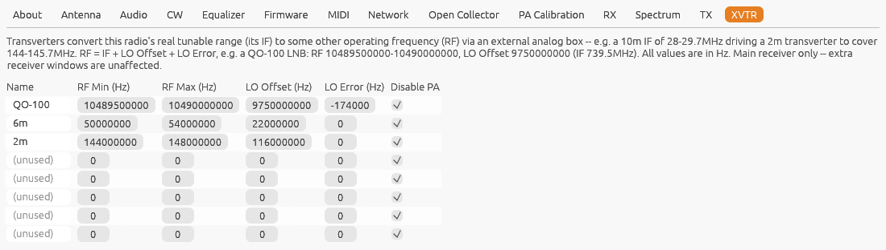

[← TX](17-settings-tx.md) | [Index](README.md) | [Ozy USB →](19-ozy-usb.md)

# Settings: XVTR

Open **Settings...** from the main window, then the **XVTR** tab.

Transverters convert this radio's real tunable range (its **IF**) to some
other operating frequency (**RF**) via an external analog box -- e.g. a 10m
IF of 28-29.7MHz driving a 2m transverter to cover 144-145.7MHz. This tab
lets you define up to 8 of them.

One row per slot, each with:

- **Name** -- anything you like; an empty name marks the slot unused (the
  other fields are ignored until you set one).
- **RF Min/Max** -- the transverter's operating range, in the frequency you
  actually want to see and work on.
- **LO Offset** -- the transverter's own local-oscillator offset, such that
  `RF = IF + LO Offset + LO Error`.
- **LO Error** -- a small trim on top of LO Offset, for whatever the real
  LO measures in practice (kept separate so you don't have to recompute the
  nominal offset every time you touch it). Scroll over it to adjust: 100 Hz
  per notch, **Alt** 10 Hz, **Shift** 1 kHz.
- **Disable PA** -- when checked, this radio's internal PA and antenna T/R
  relay are left alone while transmitting on this band, so full PA
  drive/relay switching never gets routed into a transverter's low-level IF
  input. This does **not** limit drive level by itself -- keep TX Power low
  regardless; it only stops the internal PA/relay from engaging.

All frequencies are entered in **Hz**.

### Example: QO-100 with an LNB

A QO-100 narrowband downlink (10489.5-10490 MHz) received through a
standard 9750 MHz LNB lands at an IF of 739.5-740 MHz, which an
[RTL-SDR](21-rtl-sdr.md) or [MSI.SDR](22-msi-sdr.md) can tune directly:

| Name | RF Min | RF Max | LO Offset | LO Error |
|---|---|---|---|---|
| QO-100 | 10489500000 | 10490000000 | 9750000000 | 0 |

Use LO Error to correct for your LNB's actual LO error. To follow its
drift automatically, use [PSK Beacon](02-main-window.md#psk-beacon-qo-100)'s
**Lock LNB**, which measures it from the middle beacon at 10489.750 MHz.

## Using a configured transverter

A configured, in-range slot appears as an extra button alongside the
ordinary [band row](02-main-window.md#bands-and-modes) -- only if its
corresponding IF range actually fits this radio's native tunable range.
Clicking it returns to where you last were on that transverter --
frequency, mode and spectrum levels, remembered like an ordinary band --
or to the slot's RF minimum the first time. While active:

- VFO-A, the spectrum/waterfall frequency axis, and
  [CAT/rigctl/TCI](11-settings-network.md) frequency reporting all show the
  real RF frequency, even though the radio's actual hardware LO stays at
  the true IF underneath.
- Typing a frequency into VFO-A's keypad entry (right-click VFO-A) works in
  RF too: a frequency inside a configured transverter's RF range selects
  that transverter and tunes its IF. Up to 11 digits are accepted.
- Clicking back to an ordinary band leaves the transverter and returns to
  plain IF display.
- VFO-B is shown and typed in the same RF terms while a transverter is
  active.

## Hermes-Lite 2 with the N2ADR IO board

Over Protocol 1, hpsdr-rs looks for the N2ADR HL2 IO board automatically
and, once found (Settings → Antenna says so), keeps it told:

- the **TX frequency** in RF terms (transverter offset included), which
  the board's firmware uses to switch amplifier and transverter bands;
- the **RX1 frequency code**, for its receive antenna/preselector choice;
- the **RF input mode**: any band whose RX antenna (Settings → Antenna) is
  not ANT1 uses the board's J9 receive input, and with PureSignal on, J10
  is passed through for PureSignal on TX.

The board's registers are reset once on connect. What the board does with
these values is up to its own Pico firmware.

## Limitations

- Main receiver only -- extra receiver windows and
  [PA Calibration](13-pa-calibration.md) don't know about configured
  transverters.
- This feature has not been verified against real transverter hardware --
  bench-test at low power before relying on it, same as any other TX-path
  change in this project.

---

[← TX](17-settings-tx.md) | [Index](README.md) | [Ozy USB →](19-ozy-usb.md)
